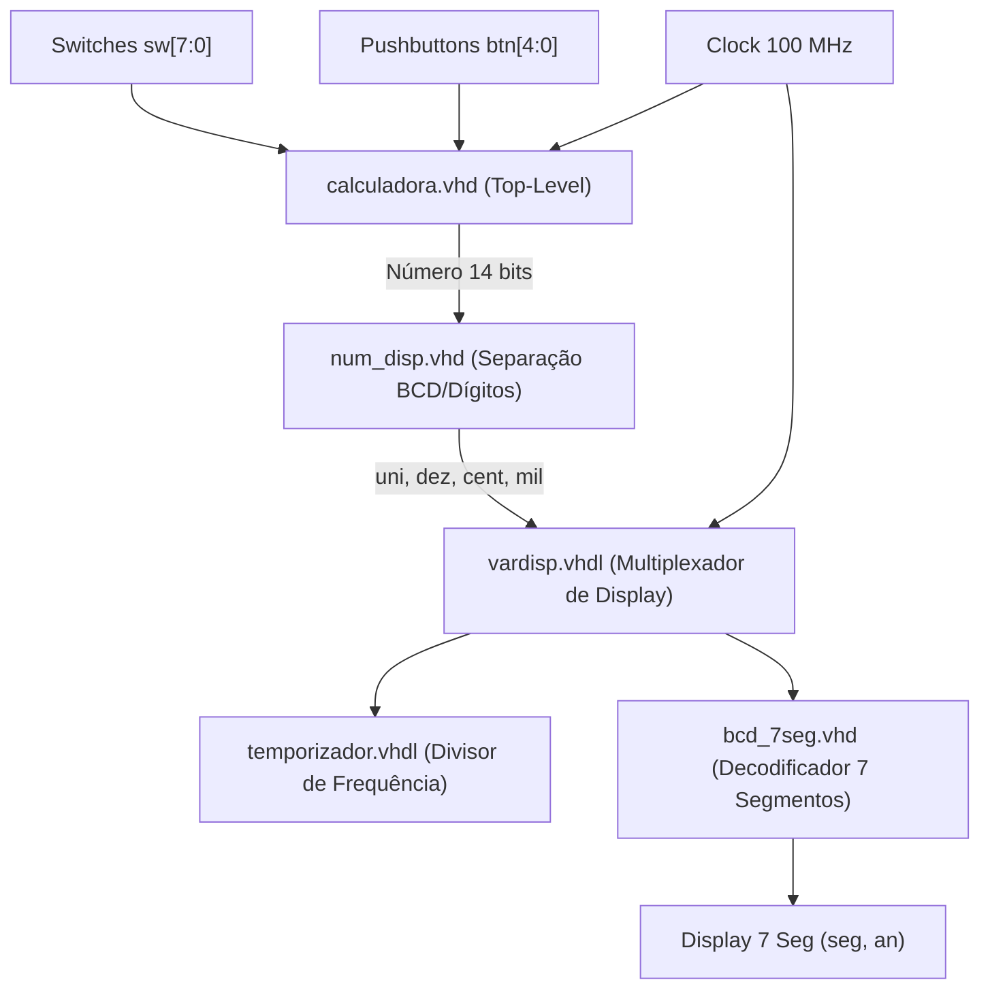

# Logica Reconfiguravel - Calculadora Digital em FPGA

Este repositório contém o projeto de uma calculadora aritmética digital com exibição dinâmica em display de 7 segmentos de 4 dígitos, desenvolvido para a disciplina de **Lógica Reconfigurável** utilizando a placa de desenvolvimento **Digilent Nexys 3** com FPGA **Xilinx Spartan-6 (XC6SLX16-CSG324)**.

O projeto inclui implementações completas em **VHDL** e em **Verilog**, arquivos de restrições de pinos (UCF), arquivos de projeto do Xilinx ISE 14.7 e bitstream pronto para gravação.

---

## 📋 Sumário

- [Visão Geral](#visão-geral)
- [Especificações de Hardware](#especificações-de-hardware)
- [Mapeamento e Interface de Usuário](#mapeamento-e-interface-de-usuário)
  - [Chaves Seletores (Switches)](#chaves-seletores-switches)
  - [Botões de Operação (Push Buttons)](#botões-de-operação-push-buttons)
  - [Displays de 7 Segmentos](#displays-de-7-segmentos)
- [Arquitetura do Sistema](#arquitetura-do-sistema)
  - [Implementação em VHDL](#implementação-em-vhdl)
  - [Implementação em Verilog](#implementação-em-verilog)
- [Estrutura de Arquivos](#estrutura-de-arquivos)
- [Como Compilar e Gravar](#como-compilar-e-gravar)

---

## 🔍 Visão Geral

O circuito realiza operações aritméticas com dois operandos ($A$ e $B$) de 7 bits configurados pelas chaves da placa Nexys 3. O resultado da operação selecionada pelos botões é convertido para decimal e exibido dinamicamente nos 4 dígitos do display de 7 segmentos com multiplexação no tempo controlada por um divisor de clock (temporizador).

Principais operações suportadas:
- Exibição direta dos operandos $A$ e $B$
- Adição ($A + B$)
- Subtração / Diferença absoluta ($|A - B|$)
- Multiplicação ($A \times B$)
- Divisão inteira ($A / B$ e $B / A$)
- Resto da divisão inteira ($A \pmod B$ e $B \pmod A$)

---

## 🛠️ Especificações de Hardware

- **Placa de Desenvolvimento**: Digilent Nexys 3 (Rev. B)
- **FPGA**: Xilinx Spartan-6 XC6SLX16-3CSG324
- **Clock do Sistema**: Oscilador onboard de 100 MHz (pino `V10`)
- **Padrão de I/O**: LVCMOS33 (3.3V)
- **Ferramenta de Síntese**: Xilinx ISE Design Suite 14.7

---

## 🎮 Mapeamento e Interface de Usuário

Conforme definido no arquivo de restrições [`Nexys3_master.ucf`](Nexys3_master.ucf):

### Chaves Seletores (Switches)

| Sinal | Pino FPGA | Função |
| :--- | :--- | :--- |
| `sw[6:0]` | `V8`, `U8`, `N8`, `M8`, `V9`, `T9`, `T10` | Valor binário de entrada (0 a 127) |
| `sw[7]` | `T5` | Seletor de operando: `0` = Operando $A$, `1` = Operando $B$ |

### Botões de Operação (Push Buttons)

Os 5 botões de pressão selecionam a operação aritmética a ser calculada e exibida nos displays:

| Botão | Pino FPGA | Código (`btn[4:0]`) | Operação Executada |
| :--- | :--- | :--- | :--- |
| **Nenhum** | - | `00000` | Mostra valor base / operando selecionado ($A$ ou $B$) |
| **BTNS** (Centro) | `B8` | `00001` | Exibe operando alternativo |
| **BTNU** (Cima) | `A8` | `00010` | **Soma**: $A + B$ |
| **BTNL** (Esquerda) | `C4` | `00100` | **Multiplicação**: $A \times B$ |
| **BTND** (Baixo) | `C9` | `01000` | **Diferença absoluta**: $\|A - B\|$ |
| **BTNR** (Direita) | `D9` | `10000` | **Divisão inteira**: $A / B$ |
| **BTNR + BTNL** | `D9` + `C4` | `10100` | **Divisão invertida**: $B / A$ |
| **BTNR + BTNU** | `D9` + `A8` | `10010` | **Resto da divisão**: $A \pmod B$ |
| **BTNR + BTND** | `D9` + `C9` | `11000` | **Resto da divisão invertida**: $B \pmod A$ |

### Displays de 7 Segmentos

- **Catodos (`seg[0:6]`)**: Segmentos `CA` a `CG` (pinos `T17`, `T18`, `U17`, `U18`, `M14`, `N14`, `L14`), ativos em nível baixo (`0`).
- **Anodos (`an[3:0]`)**: Habilitação dos 4 dígitos (pinos `P17`, `P18`, `N15`, `N16`), ativos em nível baixo (`0`), multiplexados sequencialmente a uma frequência adequada para evitar cintilação (*flicker*).

---

## 🏗️ Arquitetura do Sistema

### Implementação em VHDL



1. **[`calculadora.vhd`](calculadora.vhd)**: Top-level da implementação VHDL. Gerencia a captura dos operandos $A$ e $B$ via `sw`, executa as operações aritméticas conforme a combinação de `btn` e instancia o bloco de exibição.
2. **[`num_disp.vhd`](num_disp.vhd)**: Converte o valor numérico de até 14 bits em quatro dígitos decimais (milhar, centena, dezena, unidade) usando divisões e operações de resto.
3. **[`vardisp.vhdl`](vardisp.vhdl)**: Módulo de varredura dinâmica dos displays. Alterna entre os 4 dígitos sincronizado com o estouro do temporizador.
4. **[`temporizador.vhdl`](temporizador.vhdl) / [`timer.vhdl`](timer.vhdl)**: Divisor de clock a partir do oscilador de 100 MHz para gerar o sinal de varredura.
5. **[`bcd_7seg.vhd`](bcd_7seg.vhd)** / **[`bcd_to_7seg_display.vhd`](bcd_to_7seg_display.vhd)**: Decodificador BCD para os 7 catodos e acionamento dos anodos correspondentes.
6. **[`Binary_to_BCD.vhd`](Binary_to_BCD.vhd)**: Módulo alternativo parametrizável para conversão Binário para BCD via algoritmo Shift-Add-3 (Double Dabble).

### Implementação em Verilog

1. **[`v_calc.v`](v_calc.v)**: Top-level em Verilog correspondente ao módulo da calculadora.
2. **[`v_disp_sw.v`](v_disp_sw.v)**: Módulo multiplexador de exibição com cálculo dos dígitos e instanciação do decodificador e temporizador.
3. **[`v_bcd_7seg.v`](v_bcd_7seg.v)**: Decodificador BCD para display de 7 segmentos em Verilog.
4. **[`temporizadorv.v`](temporizadorv.v)**: Divisor de frequência parametrizável (`intervalo`) para controle do tempo de exibição.

---

## 📁 Estrutura de Arquivos

```text
├── .gitignore               # Configuração do Git para ignorar temporários do ISE
├── README.md                # Documentação do projeto
├── Lab1.xise                # Arquivo de projeto do Xilinx ISE 14.7
├── Nexys3_master.ucf        # Mapeamento de pinos e restrições para a placa Nexys 3
│
├── calculadora.vhd          # Top-level da calculadora em VHDL
├── num_disp.vhd             # Conversor de número para dígitos individuais em VHDL
├── vardisp.vhdl             # Módulo de controle e varredura do display em VHDL
├── temporizador.vhdl        # Divisor de frequência / temporizador em VHDL
├── timer.vhdl               # Temporizador auxiliar genérico em VHDL
├── bcd_7seg.vhd             # Decodificador BCD para 7 segmentos em VHDL
├── bcd_to_7seg_display.vhd  # Decodificador BCD alternativo
├── Binary_to_BCD.vhd        # Algoritmo Double Dabble para conversão BCD
├── calc.vhd / num.vhd       # Módulos base / experimentais
│
├── v_calc.v                 # Top-level da calculadora em Verilog
├── v_disp_sw.v              # Multiplexador de display em Verilog
├── v_bcd_7seg.v             # Decodificador BCD para 7 segmentos em Verilog
├── temporizadorv.v          # Temporizador / divisor de clock em Verilog
│
├── lab1.sch                 # Esquemático de testes iniciais
│
└── *.bit                    # Bitstreams compilados prontos para gravação na FPGA:
    ├── calculadora.bit      # Bitstream da calculadora completa em VHDL
    ├── v_calc.bit           # Bitstream da calculadora completa em Verilog
    ├── vardisp.bit          # Bitstream do módulo de display dinâmico
    ├── bcd_7seg.bit         # Bitstream do decodificador BCD
    ├── temporizador.bit     # Bitstream do teste de temporizador
    └── lab1.bit             # Bitstream do circuito básico
```

---

## 🚀 Como Compilar e Gravar

### Pré-requisitos
- **Xilinx ISE WebPACK / Design Suite 14.7** (ou versão compatível para Spartan-6).
- **Digilent Adept** ou **Xilinx iMPACT** para transferir o bitstream para a placa via cabo USB.

### Passos no ISE Project Navigator
1. Abra o arquivo de projeto [`Lab1.xise`](Lab1.xise) no **Xilinx ISE Project Navigator**.
2. No painel *Design/Hierarchy*, selecione a entidade desejada como top-level (`calculadora` em VHDL ou `v_calc` em Verilog).
3. Verifique se o arquivo de restrições [`Nexys3_master.ucf`](Nexys3_master.ucf) está associado ao projeto.
4. Execute o processo **Generate Programming File** para compilar e gerar o arquivo `.bit`.
5. Abra o **Digilent Adept** (ou utilize o **iMPACT**), conecte a placa Nexys 3 via USB, carregue o arquivo `.bit` (por exemplo, [`calculadora.bit`](calculadora.bit)) e clique em **Program**.
